  

# Awesome Scalable Cloud Testing Infrastructure ⚡☁️🧪

> 🚀 A curated list of top **Scalable Cloud Testing Infrastructure** platforms, distributed browser grids, mobile device farms, and load orchestration frameworks — comparing SaaS enterprise clouds and self-hosted open-source software for running test suites at massive scale.
>
> 🌟 Star this repo if you find it useful! 🌟

---

## 📋 Table of Contents 📑

- [📈 Sector Overview & Market Dynamics](#-sector-overview--market-dynamics)
- [🟦 SaaS / Hosted Platforms](#-saas--hosted-platforms)
  - [📊 SaaS Comparison Table](#-saas-comparison-table)
  - [🏢 Platform Profiles](#-platform-profiles)
- [🟩 Open-Source Software](#-open-source-software)
  - [⭐ Open-Source Ranked by Stars](#-open-source-ranked-by-stars)
  - [💻 Software Profiles](#-software-profiles)
- [📊 Comparison at a Glance](#-comparison-at-a-glance)
- [🛠️ Key Architectural Considerations](#️-key-architectural-considerations)
- [💖 Support & Sponsorship](#-support--sponsorship)
- [⭐ Star History](#-star-history)
- [🤝 Contributing](#-contributing)
- [📄 License](#-license)

---

## 📈 Sector Overview & Market Dynamics 🌐

The global cloud testing market is valued at approximately **$12.5B–$14.1B** and is projected to surpass **$35B–$44B by 2034**, expanding at a compound annual growth rate (**CAGR**) of **11%–13%**. The sector is **moderately to highly fragmented** rather than winner-take-all: hyperscale cloud providers (AWS, Microsoft Azure, Google Cloud) anchor foundational compute and infrastructure services, while specialized quality-engineering and device-cloud leaders (BrowserStack, Sauce Labs, LambdaTest, SmartBear BitBar) capture specialized testing execution through rich real-device matrices, proprietary low-latency tunneling, and AI-driven flaky test remediation agents. Concurrently, a vibrant open-source ecosystem (Selenium Grid, k6, Locust, kind, Testkube, Selenoid) empowers engineering teams with sovereign, zero-license-cost on-premise and Kubernetes-native test pipelines.

---

## 🟦 SaaS / Hosted Platforms ☁️

Commercial, managed Scalable Cloud Testing Infrastructure platforms. These hosted solutions eliminate the heavy overhead of provisioning physical device labs, maintaining browser-OS image matrices, and orchestrating ephemeral grid nodes.

### 📊 SaaS Comparison Table

The table below is sorted descending by **Company Scale (Valuation / Revenue / Market Cap)**:

| Platform | Company Scale (Valuation / Revenue) 🏢 | Starting Pricing (Automation / Entry) 💳 | Free Tier / Trial Limits 🎁 | Key Capabilities 🛠️ |
|:---|:---|:---|:---|:---|
| **[AWS Device Farm](https://aws.amazon.com/device-farm/)** | **~$2.9T Market Cap** (Amazon / AWS Segment: >$105B/yr) | **$0.17 / device minute** (Pay-as-you-go) or **$250 / slot / month** (Unmetered automated testing) | **1,000 device minutes** one-time free trial (Applies across web, iOS, and Android real devices) | 📱 Native AWS VPC/IAM integration, physical Android & iOS device pools, Appium/Espresso execution |
| **[Tricentis](https://www.tricentis.com/)** | **$4.5B Valuation** (~$500M ARR; PE-backed by GTCR & Insight Partners) | **$1,000 / user / year** (~$84/mo) for qTest; Tosca enterprise quote-based (~$20k–$100k+/yr) | **14-day free trial** with access to Tosca cloud test authoring and qTest test management | 🤖 Enterprise model-based test automation, SAP/Salesforce specialized testing, AI test authoring |
| **[BrowserStack](https://www.browserstack.com/)** | **$4.0B Valuation** (~$230M ARR; Series B led by BOND Capital) | **$99 / month** (Automate Desktop, billed annually) or **$29 / month** (Live manual testing) | **60–100 minutes** automated testing + **30 minutes** Live testing (Trial; Percy includes 5,000 free screenshots/month) | 🌐 3,500+ browser-OS matrix, Self-Healing Agent locators, Percy visual testing, 150+ CI/CD hooks |
| **[SmartBear BitBar](https://smartbear.com/product/bitbar/)** | **~$2.0B Valuation** (SmartBear parent; >$150M ARR; Vista Equity / Francisco Partners) | **$177 / month** (Unlimited Automated Testing, billed annually) or **$39 / month** (Live manual testing) | **14-day free trial** with unlimited testing minutes on real iOS/Android devices & desktop browsers | 📲 Dedicated real-device cloud, unlimited testing minutes per concurrency slot, native CI/CD integration |
| **[Sauce Labs](https://saucelabs.com/)** | **~$613M Valuation** (~$92M ARR; backed by Riverwood Capital & TPG) | **$149 / month** (Virtual Cloud Automation, billed annually) or **$39 / month** (Live manual testing) | **28-day free trial** with **60 minutes** automated & live testing across real/virtual devices + 3 parallel VMs | 🔍 Closed-loop test intelligence, 10,000+ real & virtual devices, Sauce Connect tunnels, video/error telemetry |
| **[LambdaTest (TestMu AI)](https://www.lambdatest.com/)** | **~$400M Valuation** (~$25M–$100M ARR run-rate; Series D) | **$79 / month** (Web Automation, billed annually) or **$15 / month** (Live manual testing) | **Free Forever Tier**: **100 automation minutes/lifetime**, 100 accessibility runs + 6 live sessions (10 min each) | ⚡ HyperExecute smart test orchestration, 3,000+ browser matrix, legacy browser support, SmartUI |
| **[TestingBot](https://testingbot.com/)** | **Bootstrapped** (~$1M–$5M estimated ARR; Independent) | **$50 / month** (Automated Testing, billed annually) or **$20 / month** (Live interactive testing) | **14-day free trial** with **100 minutes** testing and 1 parallel worker slot | 💻 Real browsers and mobile devices, automated headless browsers, REST API, storage of video & logs |

---

### 🏢 Platform Profiles

#### 📱 AWS Device Farm
* **Scale & Governance:** Backed by Amazon Web Services (~$2.9T parent market cap), operating across global AWS availability zones with strict compliance guarantees (SOC, ISO, HIPAA).
* **Execution Model:** Pay-per-minute ($0.17/min) or dedicated unmetered concurrency slots ($250/device slot/month). Includes a **1,000 device minutes** one-time free evaluation allowance.
* **Integrations:** Deeply integrated into AWS CodePipeline, AWS CodeBuild, Amazon CloudWatch, and AWS IAM. Supports Appium, Espresso, XCUITest, and custom test runners.
* **Best for:** AWS-native engineering organizations requiring physical device testing without establishing separate vendor contracts or third-party billing relationships.

#### 🤖 Tricentis
* **Scale & Governance:** Valued at $4.5B with ~$500M ARR; backed by GTCR and Insight Partners, serving over 60% of the Fortune 500.
* **Execution Model:** Enterprise licensing starting from $1,000/user/year for qTest test management to custom six-figure contracts for Tosca AI-driven test suites; offers a **14-day free trial** across core products.
* **Integrations:** Packaged enterprise applications (SAP, Salesforce, ServiceNow), Jira, Azure DevOps, and custom CI/CD pipelines.
* **Best for:** Large enterprise QA departments running complex end-to-end regression suites across hybrid cloud, ERP, and legacy systems.

#### 🌐 BrowserStack Automate
* **Scale & Governance:** Market unicorn valued at $4.0B with ~$230M ARR; trusted by Microsoft, Twitter, Spotify, and Nykaa.
* **Execution Model:** Entry automation starting at $99/month billed annually ($29/month for manual Live testing). Offers **60–100 trial minutes** for automation, **30 trial minutes** for Live testing, and **5,000 free screenshots/month** via Percy.
* **Key Features:** Instant access to 3,500+ browser-OS combinations, AI Self-Healing locators, dynamic Test Selection Agent, and local tunneling (Local Testing binary).
* **Best for:** Mid-market to enterprise engineering teams demanding zero-maintenance cloud Selenium/Playwright/Cypress grids with AI-assisted flaky test stabilization.

#### 📲 SmartBear BitBar
* **Scale & Governance:** Part of SmartBear's $2.0B portfolio backed by Vista Equity Partners and Francisco Partners, with over $150M in annual software revenues.
* **Execution Model:** $177/month billed annually for unlimited automated mobile/desktop testing; entry manual testing at $39/month. Free trial provides **14 days** of unlimited minutes per slot without credit card requirement.
* **Key Features:** Shared and private device clouds with physical Android/iOS hardware, unmetered parallel minutes per slot, and native frameworks support (Appium, Selenium, Espresso, XCUITest).
* **Best for:** Teams prioritizing flat-rate predictable monthly testing without per-minute overage charges.

#### 🔍 Sauce Labs
* **Scale & Governance:** Industry pioneer valued at ~$613M with ~$92M ARR, backed by Riverwood Capital and TPG.
* **Execution Model:** Virtual Cloud automation starts at $149/month billed annually; manual testing starts at $39/month. Offers a **28-day free trial** equipped with **60 minutes** testing and 3 parallel VMs.
* **Key Features:** Closed-loop agentic analytics connecting production error telemetry back to test suite prioritization, 10,000+ real & virtual devices, Sauce Connect tunnels, and visual testing.
* **Best for:** Cross-functional teams seeking deep root-cause failure analytics and unified desktop/mobile testing governance.

#### ⚡ LambdaTest (TestMu AI)
* **Scale & Governance:** Rapidly growing cloud grid valued at ~$400M, backed by Avataar, Peak XV Partners, and Qualcomm Ventures.
* **Execution Model:** Automated testing starts at $79/month billed annually; entry manual testing starts at $15/month. Includes a **Free Forever tier** with **100 lifetime automation minutes**, 100 accessibility checks, and monthly interactive sessions.
* **Key Features:** **HyperExecute** smart test runner (reducing execution times by up to 70% using intelligent test dependency caching and matrix splitting), support for 3,000+ browser/OS targets including legacy enterprise releases.
* **Best for:** Fast-moving engineering orgs running massive test suites that require aggressive parallel acceleration at cost-effective concurrency pricing.

#### 💻 TestingBot
* **Scale & Governance:** Bootstrapped, independent European test grid founded in 2011 with an estimated $1M–$5M ARR.
* **Execution Model:** Automated testing plans start at $50/month billed annually ($20/month for live testing). Includes a **14-day free trial** with **100 testing minutes** and 1 concurrency worker.
* **Key Features:** 5,100+ browser versions, headless browser clusters, physical Android/iOS devices, video recordings, and localized European data centers for strict privacy.
* **Best for:** Lean startups and cost-conscious teams needing simple, reliable cross-browser execution without high enterprise minimums.

---

## 🟩 Open-Source Software 🔓

Self-hosted, community-driven Scalable Cloud Testing Infrastructure tools. These projects allow engineering teams to retain full data sovereignty, run unlimited test hours, and deploy ephemeral execution nodes across bare metal, Docker, or Kubernetes clusters.

### ⭐ Open-Source Ranked by Stars

The table below is sorted descending by **GitHub Stars_Count**:

| Project 📦 | GitHub_Stars ⭐ | Stack 🛠️ | License 📜 | Category 🏷️ |
|:---|:---:|:---|:---|:---|
| **[SeleniumHQ/selenium](https://github.com/SeleniumHQ/selenium)** |  | Java / C# / Python / JS / Ruby | Apache-2.0 | 🌐 Browser Automation Standard & Grid Core |
| **[grafana/k6](https://github.com/grafana/k6)** |  | Go / JavaScript | AGPL-3.0 | 📈 Distributed Load & Performance Testing CLI |
| **[locustio/locust](https://github.com/locustio/locust)** |  | Python | MIT | 🦗 Distributed Developer-Friendly Load Generator |
| **[hashicorp/nomad](https://github.com/hashicorp/nomad)** |  | Go | BSL 1.1 | 🏗️ Lightweight Cluster & Workload Orchestrator |
| **[kubernetes-sigs/kind](https://github.com/kubernetes-sigs/kind)** |  | Go / Docker | Apache-2.0 | ☸️ Ephemeral Multi-Node Kubernetes Clusters |
| **[SeleniumHQ/docker-selenium](https://github.com/SeleniumHQ/docker-selenium)** |  | Bash / Docker / Python | Apache-2.0 | 🐳 Containerized Standalone & Distributed Grid Nodes |
| **[DeviceFarmer/stf](https://github.com/DeviceFarmer/stf)** |  | Node.js / AngularJS | Apache-2.0 | 📱 On-Premise Smartphone Remote Control & Farm |
| **[aerokube/selenoid](https://github.com/aerokube/selenoid)** |  | Go / Docker | Apache-2.0 | ⚡ High-Performance Lightweight Selenium Daemon |
| **[kubeshop/testkube](https://github.com/kubeshop/testkube)** |  | Go / Kubernetes CRDs | MIT (Agent) | ☸️ Kubernetes-Native Test Execution Control Plane |
| **[AppiumTestDistribution/appium-device-farm](https://github.com/AppiumTestDistribution/appium-device-farm)** |  | JavaScript / Node.js | Apache-2.0 | 📲 Appium 2.0 Plugin for Real & Virtual Device Pools |

---

### 💻 Software Profiles

#### 🌐 [SeleniumHQ/selenium](https://github.com/SeleniumHQ/selenium)

* **Stack:** Java / C# / Python / JS / Ruby | **License:** Apache-2.0
* **Architecture:** The industry-standard browser automation framework. Selenium Grid 4 includes a fully distributed architecture consisting of Router, Distributor, Session Map, New Session Queue, and Node components.
* **Key Capabilities:** Enables parallel test execution across diverse browsers, OS platforms, and architectures. Grid 4 supports GraphQL query endpoints, OpenTelemetry distributed tracing, and native Docker integration.
* **Best for:** Core foundation for custom enterprise test grids and cross-browser test automation suites.

#### 📈 [grafana/k6](https://github.com/grafana/k6)

* **Stack:** Go / JavaScript ES6 | **License:** AGPL-3.0
* **Architecture:** Modern, developer-centric performance testing tool written in Go with an embedded JavaScript runtime. Executes distributed load tests with minimal memory footprint compared to JVM-based tools.
* **Key Capabilities:** Cloud-native CLI, k6-operator for Kubernetes cluster execution, built-in thresholds, distributed metrics forwarding to Prometheus, Grafana, Datadog, and New Relic.
* **Best for:** Integrating performance and scalability regression checks into CI/CD pipelines and Kubernetes clusters.

#### 🦗 [locustio/locust](https://github.com/locustio/locust)

* **Stack:** Python / Gevent | **License:** MIT
* **Architecture:** Event-driven, distributed load testing tool. User behavior is defined purely in standard Python code without clunky XML configuration or domain-specific languages.
* **Key Capabilities:** Master-worker architecture capable of distributing millions of concurrent requests across hundreds of worker machines; interactive real-time web UI showing throughput and percentile latencies.
* **Best for:** Python-first development teams and distributed load testing against complex web APIs and microservices.

#### 🏗️ [hashicorp/nomad](https://github.com/hashicorp/nomad)

* **Stack:** Go | **License:** Business Source License (BSL) 1.1
* **Architecture:** Simple and flexible workload orchestrator capable of deploying containerized, virtualized, and standalone binary workloads across bare-metal and multi-cloud infrastructure.
* **Key Capabilities:** Dramatically lower operational complexity than Kubernetes; schedules ephemeral batch jobs and test execution runners with sub-second task startup latencies.
* **Best for:** Teams seeking scalable, multi-datacenter test workload scheduling without the management overhead of full Kubernetes clusters.

#### ☸️ [kubernetes-sigs/kind](https://github.com/kubernetes-sigs/kind)

* **Stack:** Go / Docker | **License:** Apache-2.0
* **Architecture:** Lightweight orchestration engine for running local Kubernetes clusters where each Docker container operates as a Kubernetes node.
* **Key Capabilities:** Spins up complete multi-node Kubernetes clusters within seconds; ideal for ephemeral CI pipelines testing Helm charts, operators, and cloud-native test harnesses.
* **Best for:** Ephemeral cloud test infrastructure, GitOps workflow validation, and local microservices testing.

#### 🐳 [SeleniumHQ/docker-selenium](https://github.com/SeleniumHQ/docker-selenium)

* **Stack:** Bash / Docker / Python | **License:** Apache-2.0
* **Architecture:** Official Docker images providing containerized standalone browsers, Hubs, and Nodes across Chrome, Firefox, Edge, and Chrome for Testing.
* **Key Capabilities:** Ships over 160 image variants spanning modern and historical browser versions; features embedded Fluxbox desktops with noVNC for live interactive debugging, structured JSON logging, and Kubernetes Dynamic Grid autoscaling.
* **Best for:** Teams provisioning self-managed containerized Selenium Grids on Docker Swarm, AWS ECS, or Kubernetes.

#### 📱 [DeviceFarmer/stf](https://github.com/DeviceFarmer/stf)

* **Stack:** Node.js / AngularJS / RethinkDB | **License:** Apache-2.0
* **Architecture:** Community-maintained evolution of OpenSTF (Smartphone Test Farm) for controlling and managing real Android devices remotely via browser.
* **Key Capabilities:** High-speed real-time screen capture with touch interaction, remote ADB access via local TCP port forwarding, multi-device management, and automated test orchestration support.
* **Best for:** Organizations building in-house, on-premise physical mobile device labs for manual debugging and automated app testing.

#### ⚡ [aerokube/selenoid](https://github.com/aerokube/selenoid)

* **Stack:** Go / Docker API | **License:** Apache-2.0
* **Architecture:** Lightweight, ultra-fast implementation of the Selenium hub protocol written in Go. Instead of running continuous JVM processes, Selenoid starts an ephemeral Docker container for each test session and disposes of it upon completion.
* **Key Capabilities:** Extremely low CPU and memory footprint, built-in video recording of tests, VNC browser inspection, and linear scalability without Hub bottlenecks.
* **Best for:** Teams requiring lightning-fast ephemeral browser containers with minimal resource overhead.

#### ☸️ [kubeshop/testkube](https://github.com/kubeshop/testkube)

* **Stack:** Go / Kubernetes Custom Resource Definitions (CRDs) | **License:** MIT (Open Source Agent)
* **Architecture:** Kubernetes-native test orchestration control plane. Defines, executes, and analyzes any test suite (Cypress, Playwright, Postman, k6, JMeter, Maven, Gradle) natively inside your Kubernetes cluster.
* **Key Capabilities:** Trigger tests on deployment events, CRD status changes, schedules, or CI/CD pipelines; aggregates test artifacts, metrics, and logs across multi-cluster environments with no need to expose internal APIs.
* **Best for:** DevOps and Platform Engineering teams standardizing test execution across multi-tenant Kubernetes clusters.

#### 📲 [AppiumTestDistribution/appium-device-farm](https://github.com/AppiumTestDistribution/appium-device-farm)

* **Stack:** JavaScript / Node.js | **License:** Apache-2.0
* **Architecture:** Native Appium 2.0 plugin that transforms standalone Appium servers into an autonomous, distributed mobile device farm.
* **Key Capabilities:** Dynamic allocation of connected physical Android and iOS devices, simulators, and emulators; parallel test execution, video recordings, and real-time device health monitoring.
* **Best for:** Mobile QA teams seeking an open-source, vendor-agnostic Appium device grid.

---

## 📊 Comparison at a Glance 🔍

| Solution 🛠️ | Deployment 🚀 | License / Model 📜 | Concurrency Model ⚡ | Ideal Workload 🎯 | Maintenance Overhead 🔧 |
|:---|:---|:---|:---|:---|:---|
| **AWS Device Farm** | Cloud (SaaS) | Proprietary (Pay-as-you-go) | Pay-per-min or unmetered slots | Native AWS pipelines & physical mobile testing | 🟢 Zero (Fully Managed) |
| **Tricentis** | Cloud / Enterprise | Proprietary (Annual License) | Enterprise concurrent lanes | Large enterprise ERP & regression test suites | 🟢 Low (Managed Cloud / Supported) |
| **BrowserStack** | Cloud (SaaS) | Proprietary (Subscription) | Parallel test slots (1–100+) | Fast-moving cross-browser & mobile testing | 🟢 Zero (Fully Managed) |
| **SmartBear BitBar** | Cloud (SaaS) | Proprietary (Subscription) | Unlimited minutes per slot | Flat-rate real mobile device testing | 🟢 Zero (Fully Managed) |
| **Sauce Labs** | Cloud (SaaS) | Proprietary (Subscription) | Parallel VM / device lanes | Multi-device analytics & test prioritization | 🟢 Zero (Fully Managed) |
| **LambdaTest** | Cloud (SaaS) | Proprietary (Freemium) | HyperExecute smart parallel runs | High-concurrency test suites & legacy matrix | 🟢 Zero (Fully Managed) |
| **Selenium Grid / Docker** | Self-Hosted | Apache-2.0 | Node container replicas | Sovereign cross-browser web automation | 🔴 High (OS & browser patching) |
| **grafana/k6** | Self-Hosted / Hybrid | AGPL-3.0 | Distributed virtual users (VUs) | Microservice load & API performance | 🟡 Medium (Runner provisioning) |
| **locustio/locust** | Self-Hosted | MIT | Distributed Python workers | High-throughput distributed stress testing | 🟡 Medium (Master/worker management) |
| **aerokube/selenoid** | Self-Hosted | Apache-2.0 | Ephemeral Docker containers | Ultra-fast local/CI containerized browsers | 🟡 Medium (Docker host maintenance) |
| **kubeshop/testkube** | Self-Hosted (K8s) | MIT (Agent) | Kubernetes Pod jobs | Unified multi-framework testing on K8s | 🟡 Medium (Kubernetes cluster operations) |
| **DeviceFarmer/stf** | Self-Hosted | Apache-2.0 | Physical USB/ADB hub devices | Private in-house physical smartphone farms | 🔴 High (Hardware, USB hubs, battery wear) |

---

## 🛠️ Key Architectural Considerations 📐

When selecting between commercial SaaS test clouds and self-hosted open-source testing infrastructure, evaluate these critical dimensions:

1. **Hardware Maintenance vs. Concurrency Cost:**
   * Commercial clouds charge based on **parallel concurrency slots** ($79–$250/slot/month) or usage minutes ($0.17/min). They eliminate the physical cost of broken smartphone batteries, device depreciation, and operating system updates.
   * Self-hosted device farms (DeviceFarmer STF, Appium Device Farm) require active USB hub cooling, dedicated lab space, and battery management, but provide infinite testing minutes at zero subscription fee.
2. **Ephemeral Containers vs. Long-Lived Nodes:**
   * Traditional grids often suffer from state contamination (cached cookies, leaked memory, zombie processes).
   * Modern infrastructure solutions like **aerokube/selenoid**, **Kubernetes Dynamic Grid (Grid 4.4+)**, and **kubeshop/testkube** provision an ephemeral container per test execution and destroy it immediately afterward.
3. **Network Security & Local Tunneling:**
   * Testing staging environments behind internal firewalls requires secure reverse tunneling. SaaS vendors provide validated binaries (BrowserStack Local, Sauce Connect, LambdaTest Tunnel).
   * Open-source self-hosted solutions execute directly inside your private VPC or Kubernetes cluster, eliminating data-exfiltration concerns and network latency bottlenecks.
4. **AI Capabilities & Flaky Test Stabilization:**
   * Leading SaaS platforms now incorporate agentic AI models for automatic locator repair (Self-Healing locators), historical failure analytics, and test impact selection.
   * Open-source frameworks require integration with external monitoring stacks (OpenTelemetry, Prometheus, Grafana) to achieve comparable observability.

---

## 💖 Support & Sponsorship ☕

Thank you for checking out **Awesome Scalable Cloud Testing Infrastructure**! Maintaining and curating this collection takes continuous research, benchmarking, and updates. 

If you find this repository valuable, please consider supporting the project:
* 🌟 **Star** this repository to help others discover it!
* 🍴 **Fork** and share it with your DevOps and QA teammates.
* ☕ **Buy me a coffee / Sponsor the project** via [GitHub Sponsors](https://github.com/sponsors/ishandutta2007) to help keep this list maintained and updated!

---

## ⭐ Star History

---

## 🤝 Contributing 💡

Contributions are welcome! If you know of an outstanding open-source tool, cloud testing platform, or performance testing framework that should be included, please open a pull request.

Please review the contribution guidelines:
- Ensure project is actively maintained (releases within the last 12 months).
- Add clear stack, license, Stars_Badge, and architectural use cases.
- Follow the existing Markdown formatting and table conventions.

---

## 📄 License ⚖️

This curated directory is released under the [Creative Commons Zero v1.0 Universal](LICENSE) (CC0 1.0 Public Domain). All listed software projects, trademarks, and logos belong to their respective owners.

---

  Built with ❤️ for DevOps engineers, QA architects, and platform teams worldwide. 
  🌟 Star this repository if it helped streamline your testing infrastructure! 🌟

